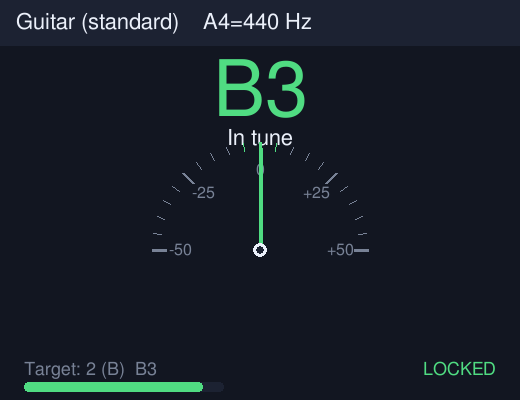
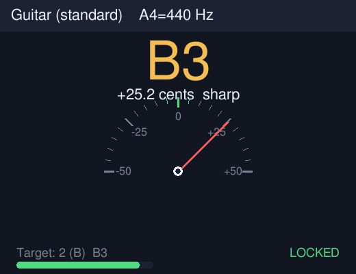
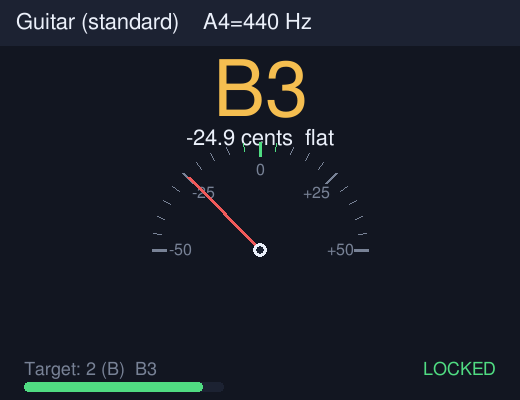
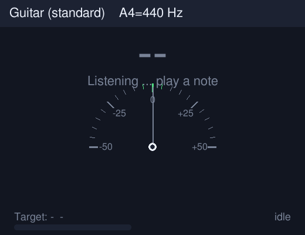

<div align="center">

# 🎣 PitchTuna · High-Precision Multi-Instrument Tuner

**One command turns your terminal into a professional tuner — accurate, good-looking and zero-friction.**

[](LICENSE)
[](https://www.python.org/)
[](CHANGELOG.md)
[](#-quick-start)

**🌐 Language: [简体中文](README.md) ｜ English ｜ [繁體中文](README.zh-TW.md)**

<sub>A tasty, high-precision, multi-instrument tuner for your terminal. 🐟🎵</sub>

</div>

---

## ⬇️ Download

- 🚀 Latest release (includes a standalone Linux binary): **<https://github.com/gitstq/pitchtuna/releases/latest>**
- 📦 For live tuning, just clone and use a one-click launcher (see [Quick Start](#-quick-start) below).

---

## 🎉 Introduction

**PitchTuna** is a **high-precision instrument tuner** that runs in your terminal. Whether you play guitar, bass, ukulele, violin, mandolin or banjo, simply play a note into the microphone and it instantly tells you:

- 🔍 which note you are playing and its frequency in Hz;
- 📏 how many **cents** you are from the target, and whether you are sharp or flat;
- 🎯 when you are in tune, the needle centers, the note turns green and shows **🔒 Locked**.

### 😮‍💨 The pain it solves

- Phone tuner apps are full of ads, demand permissions and upload data;
- hardware tuners cost money and you have to carry them;
- many open-source tuners are painful to install, driver-heavy and break across platforms;
- while practicing, recording or streaming, you want a tuner that is **always ready, clean and stable instead of jumping around**.

PitchTuna solves this with a small, cross-platform tool built on solid algorithms and very few dependencies.

### 🐟 What makes it different

- 🧠 **Three-engine fusion**: YIN (cumulative mean normalized difference) + autocorrelation + harmonic product spectrum (HPS) cross-check each other, with parabolic sub-sample interpolation; measured within **±1 cent** across the full guitar and ukulele ranges on synthetic reference signals (the practical requirement is only ±5 cents).
- 🪶 **NumPy is the only core dependency**: offline WAV analysis uses the standard library — clean, stable and auditable.
- 🧊 **Stable readings**: a lock tracker requires several consistent frames, plus a noise gate, clipping warning and harmonic confidence.
- 🧰 **13 instrument presets**: chromatic, guitar (incl. DADGAD), 4/5/6-string bass, high-/low-G ukulele, violin, viola, cello, mandolin and banjo.
- 🎛️ **Many ways to run it**: real-time terminal UI, graphical dial (optional), one-shot detection, machine-readable JSON, reference-tone generation and note/frequency conversion.
- ♻️ **Graceful degradation**: it never crashes when optional packages (`sounddevice` / `pygame`) are missing — it prints clear guidance instead.

> 💡 **Inspiration**: audio and music tools on GitHub Trending, and small, delightful desktop audio programs like the classic BongoCat. PitchTuna copies no existing code; it only borrows the idea of "solving tuning with an algorithm". All detection logic, UI and docs were written from scratch.

---

## ✨ Features

- 🎯 **Sub-cent accuracy**: YIN + parabolic interpolation, measured within **±1 cents** across the range.
- 🧩 **Three-method fusion**: autocorrelation / YIN / HPS cross-validate into one frequency and confidence.
- 🎸 **Rich tuning tables**: guitar, DADGAD, 4/5/6-string bass, high-/low-G ukulele, violin, viola, cello, mandolin, banjo and chromatic.
- 🎚️ **Session controls**: `--a4` concert pitch (440 / 442 / 432 Hz), `--capo` and `--tune-down`.
- 🧊 **Stable lock**: several frames must agree; median smoothing prevents jumpy readings.
- 🎙️ **Live microphone**: PortAudio-based (`sounddevice`), cross-platform, with device selection.
- 📄 **Offline analysis**: analyze WAV files, mono/stereo, 8/16/24/32-bit.
- 🤖 **JSON output**: easy to integrate into scripts, teaching tools and CI.
- 🎵 **Reference-tone generator**: verify and demo the whole flow without an instrument or microphone.
- 🖥️ **Graphical dial (optional)**: semicircular gauge, big note, level meter, green when locked.
- 🌍 **Trilingual docs**: Simplified Chinese, Traditional Chinese and English, with clickable switching.

---

## 🎬 Screenshots

**Graphical dial (optional `--dial`): in tune / sharp / flat / idle**

<p align="center">
  
  
  
  
</p>

**Terminal UI (live):**

```text
🎸 Guitar (standard)   A4=440 Hz
──────────────────────────────────
🎵 Detected : B3   ( 246.96 Hz)
🎯 Target   : 2 (B)  B3  ( 246.94 Hz)
📏 Cents    :   +0.1   🎯 In tune
   flat  ---------------#---------------  sharp
🎚️  Level [################--]   conf 100%   🔒 Locked
```

---

## 🚀 Quick Start

### 🧰 Requirements

- 🐍 **Python 3.9 or newer** (Windows / macOS / Linux)
- 📦 Live microphone input needs the optional `sounddevice` (the launchers install it automatically)

### 🥇 Option 1: clone + one-click launcher (recommended, live tuning)

```bash
git clone https://github.com/gitstq/pitchtuna.git
cd pitchtuna
```

- 🐧 Linux:

  ```bash
  ./run.sh
  ```

- 🍎 macOS (run in a terminal, or double-click `run.command`):

  ```bash
  ./run.command
  ```

- 🪟 Windows (double-click or run in a terminal):

  ```bat
  run.bat
  ```

The launchers install NumPy (and `sounddevice` for the microphone) automatically, then start the live tuner.

### 🥈 Option 2: install with pip

```bash
# core only (offline analysis)
pip install pitchtuna

# live microphone + graphical dial
pip install "pitchtuna[all]"
```

Then run:

```bash
pitchtuna
```

### 🥉 Option 3: no microphone / just try it

```bash
# 1) generate a set of guitar reference tones into examples/
pitchtuna --make-tones examples

# 2) analyze one of the recordings
pitchtuna --file examples/guitar_A2.wav
```

> 🎉 The default is a **live guitar tuner**. Switch instruments with `-i`, e.g. `pitchtuna -i ukulele`.

---

## 📖 Usage Guide

### 🎸 Choosing an instrument

```bash
pitchtuna -i guitar        # guitar (default)
pitchtuna -i ukulele       # high-G ukulele
pitchtuna -i bass5         # 5-string bass
pitchtuna -i violin        # violin
pitchtuna -i chromatic     # chromatic (any note)
```

List every preset:

```bash
pitchtuna --list-instruments
```

### 🎚️ Concert pitch, capo and down-tuning

```bash
pitchtuna --a4 442             # set A4 to 442 Hz
pitchtuna --capo 2             # capo on fret 2
pitchtuna --tune-down 1        # tune everything down a semitone (e.g. Eb)
pitchtuna --in-tune-cents 3    # tighten the in-tune window to ±3 cents
```

### 🎙️ Choosing a microphone

```bash
pitchtuna --list-devices
pitchtuna --device 2           # use input device index 2
```

### 📄 Analyzing a recording

```bash
pitchtuna --file note.wav                  # text result
pitchtuna --file note.wav --json           # machine-readable JSON
```

JSON fields include `frequency_hz`, `detected_note`, `target_note`, `cents`, `direction`, `in_tune`, `confidence` and `clipping`.

### ⏱️ One-shot detection (scripts / teaching)

```bash
pitchtuna --once                 # capture a few frames, report once, exit
pitchtuna --once --json          # JSON output
```

### 🖥️ Graphical dial

```bash
pitchtuna --dial                 # needs the optional pygame package
```

### 🔁 Note / frequency conversion

```bash
pitchtuna --note A4              # -> MIDI 69, 440.000 Hz
pitchtuna --freq 440             # -> A4 (MIDI 69)
```

### 🧪 Self-check

```bash
pitchtuna --smoke-test           # headless check with synthetic tones; exit 0 on success
```

### 📋 Full option reference

| Option | Description | Default |
| --- | --- | --- |
| `-i, --instrument` | instrument preset key | `guitar` |
| `--a4` | A4 concert pitch (Hz) | `440` |
| `--capo` | capo fret (semitones) | `0` |
| `--tune-down` | global down-tuning in semitones | `0` |
| `--in-tune-cents` | cents window considered in tune | `5` |
| `--sample-rate` | analysis sample rate (Hz) | `16000` |
| `--frame-size` | analysis frame size (samples) | `8192` |
| `--device` | microphone index/name | system default |
| `--file WAV` | analyze a WAV file offline | — |
| `--once` | report once and exit | off |
| `--json` | JSON output | off |
| `--dial` | graphical dial | off |
| `--smoke-test` | headless self-check | off |
| `--make-tones DIR` | generate reference tones into DIR | — |
| `--list-instruments` | list instrument presets | — |
| `--list-devices` | list microphone devices | — |
| `--note / --freq` | note/frequency conversion | — |

---

## 💡 Design & Roadmap

### 🧠 Why these choices

- **Why is YIN the primary method?** Compared to simply picking an autocorrelation peak, the cumulative mean normalized difference responds quickly to pitch changes and is robust to amplitude changes; parabolic interpolation delivers sub-cent accuracy.
- **Why also HPS and autocorrelation?** Any single method fails on noise and octave errors; fusing all three (allowing octave equivalence) makes the confidence far more reliable.
- **Why is NumPy the only core dependency?** It is the de-facto standard, cross-platform and easily fast enough when vectorized; WAV decoding stays in the standard library to minimize the attack surface and environment traps.
- **Why graceful degradation?** Microphone and graphics are extras; the core (file analysis) must keep working and never crash because an optional package is missing.

### 🗺️ Roadmap

- 🎼 More instruments and tunings (alternate/open tunings, harmonica, accordion, erhu, …);
- 📻 Strobe tuning view and finer spectrum/harmonic analysis;
- 🎛️ ASIO / JACK pro-audio support and lower latency;
- 🌐 A WebAssembly build for in-browser tuning;
- 🌍 Additional docs (Japanese, Korean, Spanish, …);
- 🧩 A fuller Python-library API with examples.

Share ideas in [Discussions](https://github.com/gitstq/pitchtuna/discussions) / Issues.

---

## 📦 Packaging & Deployment

### 🐧 Standalone Linux binary

The release ships a **standalone Linux x86_64 file** (offline analysis), verified in the build environment:

1. Download and extract:

   ```bash
   tar xzf pitchtuna-1.0.0-linux-x86_64.tar.gz
   cd pitchtuna-1.0.0-linux-x86_64
   ```

2. Run:

   ```bash
   ./pitchtuna --file your.wav
   ./pitchtuna --list-instruments
   ```

3. Verify integrity against `SHA256SUMS.txt` on the [release page](https://github.com/gitstq/pitchtuna/releases/latest):

   ```bash
   sha256sum -c SHA256SUMS.txt
   ```

> ⚠️ **Live microphone and cross-platform binaries**: the build/release environment had no audio input device, so **live capture is not bundled in or verified for the standalone binary**. For live tuning use the source launchers (`run.sh` / `run.bat` / `run.command`), which install and run on your real machine — the most reliable cross-platform path.

### 🪟 Windows / 🍎 macOS

Use `run.bat` (Windows) or `run.command` (macOS) with Python 3.9+; the launchers install dependencies and start live tuning automatically.

### 🛠️ Building from source

```bash
pip install pyinstaller
pyinstaller --onefile --name pitchtuna --paths . packaging/launcher.py
```

---

## 🤝 Contributing

Issues, doc improvements and pull requests are very welcome! Please read [CONTRIBUTING.md](CONTRIBUTING.md):

- 🔀 Commit messages follow Conventional Commits (`feat:` / `fix:` / `docs:` / `refactor:` / `test:` …);
- 🧪 Run `python -m unittest discover -s tests` and `pitchtuna --smoke-test` before submitting;
- 🌍 Translations should read naturally in the target language rather than literal machine translation.

---

## 📄 License

Released under the **[MIT License](LICENSE)** — free to use, modify and distribute.

<div align="center">

<sub>🐟 Made with ❤️ by <a href="https://github.com/gitstq">gitstq</a> · If PitchTuna helped you tune, leave a ⭐ !</sub>

</div>
