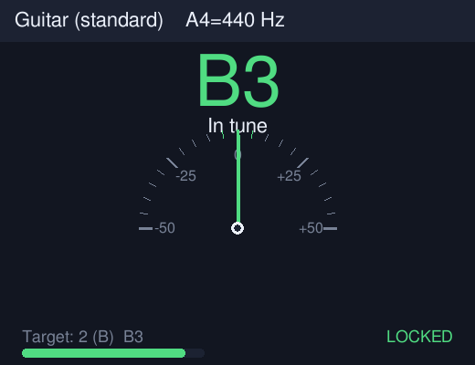
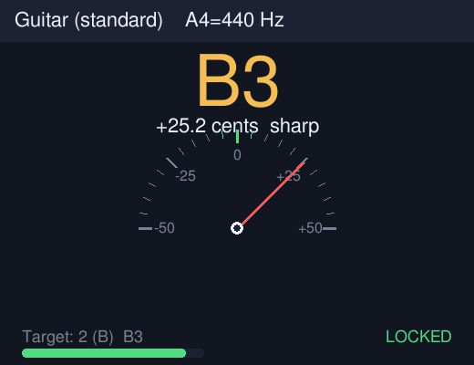
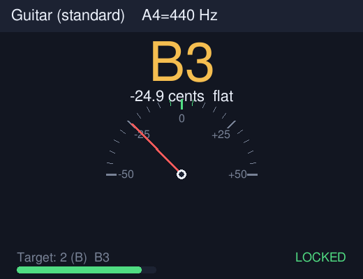
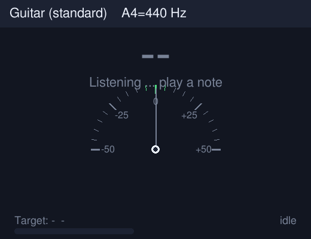

<div align="center">

# 🎣 PitchTuna · 高精度多乐器调音器

**一条命令，把你的终端变成一台专业调音器 —— 精准、好看、零门槛。**

[](LICENSE)
[](https://www.python.org/)
[](CHANGELOG.md)
[](#-快速开始)

**🌐 语言 / Language： 简体中文 ｜ [English](README.en.md) ｜ [繁體中文](README.zh-TW.md)**

<sub>A tasty, high-precision, multi-instrument tuner for your terminal. 🐟🎵</sub>

</div>

---

## ⬇️ 下载

- 🚀 最新版本（含 Linux 独立可执行文件）：**<https://github.com/gitstq/pitchtuna/releases/latest>**
- 📦 实时调音推荐直接克隆后用一键脚本（见下方[快速开始](#-快速开始)）。

---

## 🎉 项目介绍

**PitchTuna** 是一款运行在终端里的**高精度乐器调音器**。无论是吉他、贝斯、尤克里里，还是小提琴、曼陀林、班卓，只要对着麦克风弹一个音，它就能立刻告诉你：

- 🔍 当前是什么音、频率是多少 Hz；
- 📏 离目标音**差了多少音分（cents）**，是偏高还是偏低；
- 🎯 当你调准时，指针回正、音符变绿并显示 **🔒 Locked**。

### 😮‍💨 它解决的痛点

- 手机调音器 App 满屏广告、要权限、还偷偷上传；
- 硬件调音器要花钱、要带在身上；
- 很多开源调音器安装麻烦、驱动一堆、跨平台就崩；
- 练琴/录音/直播时，想要一个**随时可用、界面清爽、读数稳定不乱跳**的调音器。

PitchTuna 用一个**核心算法扎实、依赖极少、跨平台**的小工具解决这些问题。

### 🐟 自研差异化亮点

- 🧠 **三引擎融合检测**：YIN（累积均值归一化差分）+ 自相关 + 谐波乘积谱（HPS）相互校验，抛物线亚采样插值；在吉他、尤克里里全音域的合成参考信号上，**误差小于 ±1 音分**（人耳/调音的行业要求仅为 ±5 音分）。
- 🪶 **核心仅依赖 NumPy**：离线分析 WAV 只用标准库，干净、稳定、可审计。
- 🧊 **读数稳定不抖**：内置"稳定锁定"跟踪器，连续数帧一致才锁定，噪声门 + 削波提示 + 谐波置信度。
- 🧰 **13 种乐器预设**：十二平均律、吉他（含 DADGAD）、4/5/6 弦贝斯、高/低 G 尤克里里、小提琴、中提琴、大提琴、曼陀林、班卓。
- 🎛️ **多种用法**：实时终端界面、图形表盘（可选）、单次检测、机器可读 JSON、参考音生成、音名/频率互转。
- ♻️ **优雅降级**：可选依赖（`sounddevice` / `pygame`）缺失时绝不崩溃，自动给出清晰提示。

> 💡 **灵感来源**：GitHub Trending 上的音频与音乐工具，以及经典的 BongoCat 一类"小而美"的桌面音频程序。PitchTuna 没有复制任何现有项目的代码，仅参考"用算法解决调音"这一产品思路，全部检测逻辑、界面与文档均为独立自研。

---

## ✨ 核心特性

- 🎯 **亚音分级精度**：YIN + 抛物线插值，实测全音域 **±1 cents** 以内。
- 🧩 **三算法融合**：自相关 / YIN / HPS 交叉验证，输出统一频率与置信度。
- 🎸 **丰富调音表**：吉他、DADGAD、4/5/6 弦贝斯、高/低 G 尤克里里、小提琴、中提琴、大提琴、曼陀林、班卓、十二平均律。
- 🎚️ **音乐会话可调**：`--a4` 音乐会话（440 / 442 / 432 Hz）、`--capo` 变调夹、`--tune-down` 降调。
- 🧊 **稳定锁定**：多帧一致才锁定，中值平滑，杜绝读数乱跳。
- 🎙️ **实时麦克风**：基于 PortAudio（`sounddevice`），跨平台，支持设备选择。
- 📄 **离线分析**：直接分析 WAV 文件，支持单声道/立体声、8/16/24/32-bit。
- 🤖 **JSON 输出**：方便脚本、教学软件、CI 集成。
- 🎵 **参考音生成**：没有乐器/麦克风也能一键生成标准音并演示完整流程。
- 🖥️ **图形表盘（可选）**：半圆仪表 + 大音符 + 电平表，锁定变绿。
- 🌍 **三语文档**：简体中文、繁體中文、English，可点击切换。

---

## 🎬 效果展示

**图形表盘（可选 `--dial`）：调准 / 偏高 / 偏低 / 待机**

<p align="center">
  
  
  
  
</p>

**终端界面（实时）：**

```text
🎸 Guitar (standard)   A4=440 Hz
──────────────────────────────────
🎵 Detected : B3   ( 246.96 Hz)
🎯 Target   : 2 (B)  B3  ( 246.94 Hz)
📏 Cents    :   +0.1   🎯 In tune
   flat  ---------------#---------------  sharp
🎚️  Level [################--]   conf 100%   🔒 Locked
```

---

## 🚀 快速开始

### 🧰 环境要求

- 🐍 **Python 3.9 或更高版本**（Windows / macOS / Linux 均可）
- 📦 实时麦克风需要可选依赖 `sounddevice`（一键脚本会自动安装）

### 🥇 方式一：克隆 + 一键脚本（推荐，实时调音）

```bash
git clone https://github.com/gitstq/pitchtuna.git
cd pitchtuna
```

- 🐧 Linux：

  ```bash
  ./run.sh
  ```

- 🍎 macOS（终端中执行，或双击 `run.command`）：

  ```bash
  ./run.command
  ```

- 🪟 Windows（双击或在命令行运行）：

  ```bat
  run.bat
  ```

脚本会自动安装 NumPy（以及实时麦克风需要的 sounddevice），随后启动实时调音器。

### 🥈 方式二：pip 安装

```bash
# 仅核心（离线分析）
pip install pitchtuna

# 实时麦克风 + 图形表盘
pip install "pitchtuna[all]"
```

随后直接运行：

```bash
pitchtuna
```

### 🥉 方式三：没有麦克风 / 先体验一下

```bash
# 1) 生成一套吉他标准音到 examples/
pitchtuna --make-tones examples

# 2) 分析其中一个录音
pitchtuna --file examples/guitar_A2.wav
```

> 🎉 首次使用默认是**吉他实时调音**。换乐器只需加 `-i`，例如 `pitchtuna -i ukulele`。

---

## 📖 详细使用指南

### 🎸 选择乐器

```bash
pitchtuna -i guitar        # 吉他（默认）
pitchtuna -i ukulele       # 高 G 尤克里里
pitchtuna -i bass5         # 5 弦贝斯
pitchtuna -i violin        # 小提琴
pitchtuna -i chromatic     # 十二平均律（任意音）
```

查看全部预设：

```bash
pitchtuna --list-instruments
```

### 🎚️ 音乐会话、变调夹、降调

```bash
pitchtuna --a4 442             # 把 A4 设为 442 Hz
pitchtuna --capo 2             # 变调夹夹 2 品
pitchtuna --tune-down 1        # 整体降半音（如 Eb 调弦）
pitchtuna --in-tune-cents 3    # 把"准"的窗口收紧到 ±3 cents
```

### 🎙️ 选择麦克风设备

```bash
pitchtuna --list-devices
pitchtuna --device 2           # 用索引为 2 的输入设备
```

### 📄 分析录音文件

```bash
pitchtuna --file note.wav                  # 文本结果
pitchtuna --file note.wav --json           # 机器可读 JSON
```

JSON 字段示例：`frequency_hz`、`detected_note`、`target_note`、`cents`、`direction`、`in_tune`、`confidence`、`clipping` 等。

### ⏱️ 单次检测（脚本/教学场景）

```bash
pitchtuna --once                 # 采集几帧，报告一次后退出
pitchtuna --once --json          # 输出 JSON
```

### 🖥️ 图形表盘

```bash
pitchtuna --dial                 # 需要可选依赖 pygame
```

### 🔁 音名 / 频率互转

```bash
pitchtuna --note A4              # -> MIDI 69, 440.000 Hz
pitchtuna --freq 440             # -> A4 (MIDI 69)
```

### 🧪 自检

```bash
pitchtuna --smoke-test           # 用合成音做无头自检，成功退出码为 0
```

### 📋 完整参数表

| 参数 | 说明 | 默认值 |
| --- | --- | --- |
| `-i, --instrument` | 乐器预设 key | `guitar` |
| `--a4` | A4 音乐会话频率（Hz） | `440` |
| `--capo` | 变调夹品位（半音数） | `0` |
| `--tune-down` | 整体降调半音数 | `0` |
| `--in-tune-cents` | 视为"准"的音分窗口 | `5` |
| `--sample-rate` | 分析采样率（Hz） | `16000` |
| `--frame-size` | 分析帧长（样本） | `8192` |
| `--device` | 麦克风设备索引/名称 | 系统默认 |
| `--file WAV` | 离线分析 WAV 文件 | — |
| `--once` | 单次检测后退出 | 关 |
| `--json` | JSON 输出 | 关 |
| `--dial` | 图形表盘 | 关 |
| `--smoke-test` | 无头自检 | 关 |
| `--make-tones DIR` | 生成参考音到 DIR | — |
| `--list-instruments` | 列出乐器预设 | — |
| `--list-devices` | 列出麦克风设备 | — |
| `--note / --freq` | 音名/频率互转 | — |

---

## 💡 设计思路与迭代规划

### 🧠 为什么这样设计

- **为什么用 YIN 作为主算法？** 相比单纯找自相关峰值，YIN 的累积均值归一化差分对音高变化响应快、对幅度变化更鲁棒，配合抛物线插值能做到亚音分级精度。
- **为什么还要 HPS 与自相关？** 单一算法都会在噪声、八度错误上翻车；三者融合、允许"八度等价"，能显著提升置信度判断的可靠性。
- **为什么核心只依赖 NumPy？** NumPy 是事实标准、跨平台、向量化后实时轻松；离线 WAV 解码交给 Python 标准库，最小化攻击面与环境陷阱。
- **为什么要优雅降级？** 麦克风/图形属于增强能力，缺失时核心（文件分析）必须照常可用，绝不因可选依赖报错而崩溃。

### 🗺️ 后续迭代计划

- 🎼 更多乐器与调弦（多调弦预设、开放调弦、口琴、手风琴、二胡等）；
- 📻 频闪（strobe）调音视图与更细的频谱/谐波分析；
- 🎛️ ASIO / JACK 专业音频接口支持与更低延迟；
- 🌐 WebAssembly 版本，浏览器内直接调音；
- 🌍 补充日语、韩语、西班牙语等文档；
- 🧩 作为 Python 库的更完整 API 与示例。

欢迎在 [Discussions](https://github.com/gitstq/pitchtuna/discussions) / Issues 提出想法。

---

## 📦 打包与部署

### 🐧 Linux 独立可执行

Release 提供经构建环境实测的 **Linux x86_64 单文件**（离线分析）：

1. 下载并解压：

   ```bash
   tar xzf pitchtuna-1.0.0-linux-x86_64.tar.gz
   cd pitchtuna-1.0.0-linux-x86_64
   ```

2. 运行：

   ```bash
   ./pitchtuna --file your.wav
   ./pitchtuna --list-instruments
   ```

3. 校验完整性（对比 [Release](https://github.com/gitstq/pitchtuna/releases/latest) 页面的 `SHA256SUMS.txt`）：

   ```bash
   sha256sum -c SHA256SUMS.txt
   ```

> ⚠️ **关于实时麦克风与跨平台二进制**：构建/发布环境没有音频输入设备，因此**实时麦克风采集未在该独立二进制中实测与内置**；需要实时调音请使用源码一键脚本（`run.sh` / `run.bat` / `run.command`），它们会在你的真实机器上自动安装并运行，这是最可靠的跨平台方式。

### 🪟 Windows / 🍎 macOS

使用仓库内的 `run.bat`（Windows）或 `run.command`（macOS），需安装 Python 3.9+；脚本会自动建依赖并启动实时调音。

### 🛠️ 从源码自行打包

```bash
pip install pyinstaller
pyinstaller --onefile --name pitchtuna --paths . packaging/launcher.py
```

---

## 🤝 贡献指南

欢迎提交 Issue、改进文档或发起 Pull Request！请阅读 [CONTRIBUTING.md](CONTRIBUTING.md)：

- 🔀 提交信息遵循 Conventional Commits（`feat:` / `fix:` / `docs:` / `refactor:` / `test:` …）；
- 🧪 提交前请运行 `python -m unittest discover -s tests` 与 `pitchtuna --smoke-test`；
- 🌍 翻译请使用自然、地道的母语表达，不要生硬机翻。

---

## 📄 开源协议

本项目基于 **[MIT License](LICENSE)** 开源，可自由使用、修改与分发。

<div align="center">

<sub>🐟 Made with ❤️ by <a href="https://github.com/gitstq">gitstq</a> · If PitchTuna helped you tune, give it a ⭐ !</sub>

</div>
