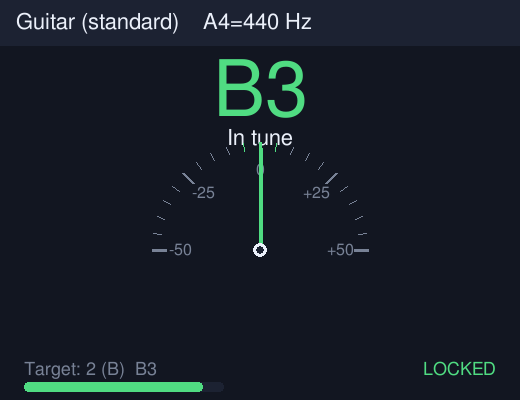
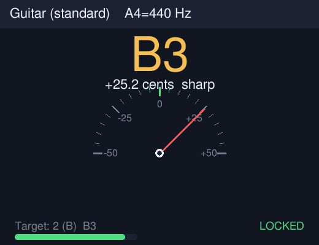
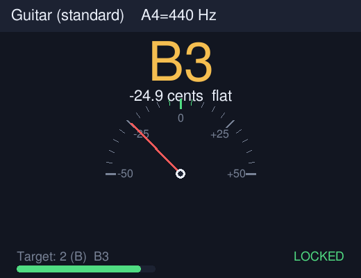
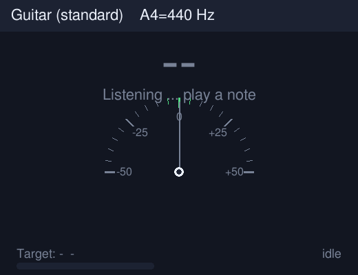

<div align="center">

# 🎣 PitchTuna · 高精度多樂器調音器

**一道指令，把你的終端機變成一台專業調音器 —— 精準、好看、零門檻。**

[](LICENSE)
[](https://www.python.org/)
[](CHANGELOG.md)
[](#-快速開始)

**🌐 語言： [简体中文](README.md) ｜ [English](README.en.md) ｜ 繁體中文**

<sub>A tasty, high-precision, multi-instrument tuner for your terminal. 🐟🎵</sub>

</div>

---

## ⬇️ 下載

- 🚀 最新版本（含 Linux 獨立執行檔）：**<https://github.com/gitstq/pitchtuna/releases/latest>**
- 📦 要即時調音，建議直接克隆後使用一鍵啟動腳本（見下方[快速開始](#-快速開始)）。

---

## 🎉 專案介紹

**PitchTuna** 是一款執行在終端機裡的**高精度樂器調音器**。不論是吉他、貝斯、烏克麗麗，還是以小提琴、曼陀林、班卓琴，只要對著麥克風彈一個音，它會立刻告訴你：

- 🔍 目前是什麼音、頻率是多少 Hz；
- 📏 跟目標音**差了多少音分（cents）**，是偏高還是偏低；
- 🎯 當你調準時，指標回正、音符變綠並顯示 **🔒 Locked（鎖定）**。

### 😮‍💨 解決的痛點

- 手機調音器 App 廣告滿版、要權限、還會偷偷上傳資料；
- 硬體調音器要花錢、還得隨身攜帶；
- 許多開源調音器安裝麻煩、驅動一堆、跨平台就壞掉；
- 練琴／錄音／直播時，想要一個**隨時可用、介面清爽、讀數穩定不亂跳**的調音器。

PitchTuna 用一個**核心演算法紮實、相依套件極少、跨平台**的小工具來解決這些問題。

### 🐟 自研差異化亮點

- 🧠 **三引擎融合偵測**：YIN（累積均值正規化差分）＋自相關＋諧波乘積譜（HPS）互相驗證，拋物線亞取樣插值；在吉他、烏克麗麗全音域的合成參考訊號上，**誤差小於 ±1 音分**（人耳／調音的實務要求僅 ±5 音分）。
- 🪶 **核心僅相依 NumPy**：離線分析 WAV 只使用標準函式庫，乾淨、穩定、可檢視。
- 🧊 **讀數穩定不抖**：內建「穩定鎖定」追蹤器，連續數幀一致才鎖定，並具備雜訊門、削波提示與諧波信心值。
- 🧰 **13 種樂器預設**：十二平均律、吉他（含 DADGAD）、4/5/6 弦貝斯、高／低 G 烏克麗麗、小提琴、中提琴、大提琴、曼陀林、班卓琴。
- 🎛️ **多種用法**：即時終端介面、圖形錶盤（選配）、單次偵測、機器可讀 JSON、參考音產生、音名／頻率互轉。
- ♻️ **優雅降級**：選配相依套件（`sounddevice`／`pygame`）缺少時絕不崩潰，會自動給出清楚提示。

> 💡 **靈感來源**：GitHub Trending 上的音訊與音樂工具，以及經典 BongoCat 這類「小而美」的桌面音樂程式。PitchTuna 沒有複製任何現有專案的程式碼，僅參考「用演算法解決調音」這個產品思路，所有偵測邏輯、介面與文件皆為獨立自研。

---

## ✨ 核心特性

- 🎯 **亞音分級精度**：YIN ＋拋物線插值，實測全音域在 **±1 cents** 以內。
- 🧩 **三演算法融合**：自相關／YIN／HPS 交叉驗證，輸出統一頻率與信心值。
- 🎸 **豐富調音表**：吉他、DADGAD、4/5/6 弦貝斯、高／低 G 烏克麗麗、小提琴、中提琴、大提琴、曼陀林、班卓琴、十二平均律。
- 🎚️ **音樂會話可調**：`--a4` 音高（440／442／432 Hz）、`--capo` 移調夾、`--tune-down` 降音。
- 🧊 **穩定鎖定**：多幀一致才鎖定，中位數平滑，杜絕讀數亂跳。
- 🎙️ **即時麥克風**：以 PortAudio（`sounddevice`）為基礎，跨平台，支援裝置選擇。
- 📄 **離線分析**：直接分析 WAV 檔案，支援單聲道／立體聲、8/16/24/32-bit。
- 🤖 **JSON 輸出**：方便腳本、教學軟體與 CI 整合。
- 🎵 **參考音產生**：沒有樂器／麥克風也能一鍵產生標準音並展示完整流程。
- 🖥️ **圖形錶盤（選配）**：半圓儀表＋大音符＋電平表，鎖定時變綠。
- 🌍 **三語文件**：簡體中文、繁體中文、English，可點擊切換。

---

## 🎬 效果展示

**圖形錶盤（選配 `--dial`）：調準／偏高／偏低／待機**

<p align="center">
  
  
  
  
</p>

**終端介面（即時）：**

```text
🎸 Guitar (standard)   A4=440 Hz
──────────────────────────────────
🎵 Detected : B3   ( 246.96 Hz)
🎯 Target   : 2 (B)  B3  ( 246.94 Hz)
📏 Cents    :   +0.1   🎯 In tune
   flat  ---------------#---------------  sharp
🎚️  Level [################--]   conf 100%   🔒 Locked
```

---

## 🚀 快速開始

### 🧰 環境需求

- 🐍 **Python 3.9 或更新版本**（Windows／macOS／Linux 皆可）
- 📦 即時麥克風需要選配套件 `sounddevice`（一鍵腳本會自動安裝）

### 🥇 方式一：克隆＋一鍵腳本（推薦，即時調音）

```bash
git clone https://github.com/gitstq/pitchtuna.git
cd pitchtuna
```

- 🐧 Linux：

  ```bash
  ./run.sh
  ```

- 🍎 macOS（於終端機執行，或點兩下 `run.command`）：

  ```bash
  ./run.command
  ```

- 🪟 Windows（點兩下或於命令列執行）：

  ```bat
  run.bat
  ```

腳本會自動安裝 NumPy（以及即時麥克風需要的 sounddevice），接著啟動即時調音器。

### 🥈 方式二：pip 安裝

```bash
# 僅核心（離線分析）
pip install pitchtuna

# 即時麥克風＋圖形錶盤
pip install "pitchtuna[all]"
```

接著直接執行：

```bash
pitchtuna
```

### 🥉 方式三：沒有麥克風／先體驗看看

```bash
# 1) 產生一套吉他標準音到 examples/
pitchtuna --make-tones examples

# 2) 分析其中一個錄音
pitchtuna --file examples/guitar_A2.wav
```

> 🎉 預設是**吉他即時調音**。換樂器只要加 `-i`，例如 `pitchtuna -i ukulele`。

---

## 📖 詳細使用指南

### 🎸 選擇樂器

```bash
pitchtuna -i guitar        # 吉他（預設）
pitchtuna -i ukulele       # 高 G 烏克麗麗
pitchtuna -i bass5         # 5 弦貝斯
pitchtuna -i violin        # 小提琴
pitchtuna -i chromatic     # 十二平均律（任意音）
```

檢視全部預設：

```bash
pitchtuna --list-instruments
```

### 🎚️ 音高、移調夾、降音

```bash
pitchtuna --a4 442             # 把 A4 設為 442 Hz
pitchtuna --capo 2             # 移調夾夾 2 格
pitchtuna --tune-down 1        # 整體降半音（如 Eb 調弦）
pitchtuna --in-tune-cents 3    # 把「準」的範圍縮到 ±3 cents
```

### 🎙️ 選擇麥克風裝置

```bash
pitchtuna --list-devices
pitchtuna --device 2           # 使用索引為 2 的輸入裝置
```

### 📄 分析錄音檔案

```bash
pitchtuna --file note.wav                  # 文字結果
pitchtuna --file note.wav --json           # 機器可讀 JSON
```

JSON 欄位範例：`frequency_hz`、`detected_note`、`target_note`、`cents`、`direction`、`in_tune`、`confidence`、`clipping` 等。

### ⏱️ 單次偵測（腳本／教學場景）

```bash
pitchtuna --once                 # 擷取幾幀，回報一次後退出
pitchtuna --once --json          # 輸出 JSON
```

### 🖥️ 圖形錶盤

```bash
pitchtuna --dial                 # 需要選配套件 pygame
```

### 🔁 音名／頻率互轉

```bash
pitchtuna --note A4              # -> MIDI 69, 440.000 Hz
pitchtuna --freq 440             # -> A4 (MIDI 69)
```

### 🧪 自我檢測

```bash
pitchtuna --smoke-test           # 用合成音做無頭自我檢測，成功時結束代碼為 0
```

### 📋 完整參數表

| 參數 | 說明 | 預設值 |
| --- | --- | --- |
| `-i, --instrument` | 樂器預設 key | `guitar` |
| `--a4` | A4 音高頻率（Hz） | `440` |
| `--capo` | 移調夾格數（半音數） | `0` |
| `--tune-down` | 整體降音半音數 | `0` |
| `--in-tune-cents` | 視為「準」的音分範圍 | `5` |
| `--sample-rate` | 分析取樣率（Hz） | `16000` |
| `--frame-size` | 分析幀長（樣本） | `8192` |
| `--device` | 麥克風裝置索引／名稱 | 系統預設 |
| `--file WAV` | 離線分析 WAV 檔案 | — |
| `--once` | 單次偵測後退出 | 關 |
| `--json` | JSON 輸出 | 關 |
| `--dial` | 圖形錶盤 | 關 |
| `--smoke-test` | 無頭自我檢測 | 關 |
| `--make-tones DIR` | 產生參考音到 DIR | — |
| `--list-instruments` | 列出樂器預設 | — |
| `--list-devices` | 列出麥克風裝置 | — |
| `--note / --freq` | 音名／頻率互轉 | — |

---

## 💡 設計思路與迭代規劃

### 🧠 為什麼這樣設計

- **為什麼用 YIN 作為主要演算法？** 相較於單純找自相關峰值，YIN 的累積均值正規化差分對音高變化反應快、對幅度變化更穩定，搭配拋物線插值可做到亞音分級精度。
- **為什麼還要 HPS 與自相關？** 單一演算法都會在雜訊、八度錯誤上出錯；三者融合、允許「八度等價」，能大幅提升信心值判斷的可靠度。
- **為什麼核心只相依 NumPy？** NumPy 是業界事實標準、跨平台、向量化後即時運算輕鬆；離線 WAV 解碼交給 Python 標準函式庫，把攻擊面與環境陷阱降到最低。
- **為什麼要優雅降級？** 麥克風／圖形屬於強化功能，缺少時核心（檔案分析）必須照常運作，絕不因選配套件出錯而崩潰。

### 🗺️ 後續迭代計畫

- 🎼 更多樂器與調弦（多種調弦預設、開放調弦、口琴、手風琴、二胡等）；
- 📻 頻閃（strobe）調音視圖與更細的頻譜／諧波分析；
- 🎛️ ASIO／JACK 專業音訊介面支援與更低延遲；
- 🌐 WebAssembly 版本，於瀏覽器內直接調音；
- 🌍 補充日文、韓文、西班牙文等文件；
- 🧩 更完整的 Python 函式庫 API 與範例。

歡迎於 [Discussions](https://github.com/gitstq/pitchtuna/discussions)／Issues 提出想法。

---

## 📦 打包與部署

### 🐧 Linux 獨立執行檔

Release 提供已於建置環境實測的 **Linux x86_64 單一檔案**（離線分析）：

1. 下載並解壓縮：

   ```bash
   tar xzf pitchtuna-1.0.0-linux-x86_64.tar.gz
   cd pitchtuna-1.0.0-linux-x86_64
   ```

2. 執行：

   ```bash
   ./pitchtuna --file your.wav
   ./pitchtuna --list-instruments
   ```

3. 驗證完整性（對照 [Release](https://github.com/gitstq/pitchtuna/releases/latest) 頁面的 `SHA256SUMS.txt`）：

   ```bash
   sha256sum -c SHA256SUMS.txt
   ```

> ⚠️ **關於即時麥克風與跨平台執行檔**：建置／發布環境沒有音訊輸入裝置，因此**即時麥克風擷取未於此獨立執行檔中實測與內建**；需要即時調音請使用原始碼一鍵腳本（`run.sh`／`run.bat`／`run.command`），它們會在你的真實機器上自動安裝並執行，這是最可靠的跨平台方式。

### 🪟 Windows／🍎 macOS

使用專案內的 `run.bat`（Windows）或 `run.command`（macOS），需安裝 Python 3.9+；腳本會自動建立相依套件並啟動即時調音。

### 🛠️ 從原始碼自行打包

```bash
pip install pyinstaller
pyinstaller --onefile --name pitchtuna --paths . packaging/launcher.py
```

---

## 🤝 貢獻指南

歡迎提交 Issue、改進文件或發起 Pull Request！請閱讀 [CONTRIBUTING.md](CONTRIBUTING.md)：

- 🔀 提交訊息遵循 Conventional Commits（`feat:`／`fix:`／`docs:`／`refactor:`／`test:` …）；
- 🧪 提交前請執行 `python -m unittest discover -s tests` 與 `pitchtuna --smoke-test`；
- 🌍 翻譯請使用自然、道地的母語語感，不要生硬機翻。

---

## 📄 開源授權

本專案以 **[MIT License](LICENSE)** 開源，可自由使用、修改與散布。

<div align="center">

<sub>🐟 Made with ❤️ by <a href="https://github.com/gitstq">gitstq</a> · If PitchTuna helped you tune, give it a ⭐ !</sub>

</div>
